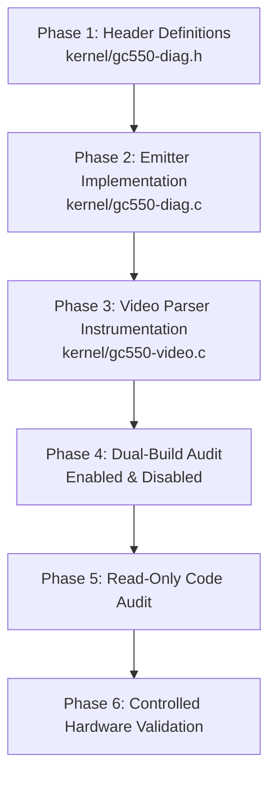

# E1.9 Stage 2B – Parser Telemetry Architecture and Diagnostic Design Specification (Revision 2)

**Project:** `lgx2KernelLevel`  
**Hardware:** AVerMedia Live Gamer Extreme GC550 (USB ID `07ca:4710`)  
**Video Endpoint:** Bulk IN `0x83`  
**Baseline:** E1.9 Revision 4  
**Target:** Stage 2B – Passive Parser State and Marker Telemetry  
**Maintainer:** Øystein Lie  
**Status:** ARCHITECTURE DESIGN REVISION 2 (READ-ONLY AUDIT)  
**Date:** 2026-11-12  

---

## 1. Executive Summary

This document establishes the revised architectural specification for **Stage 2B (Passive Parser State and Marker Telemetry)** of the `lgx2KernelLevel` driver. It supersedes Revision 1 following an independent, read-only technical audit of maintainer requirements, physical hardware test artifacts, and kernel source code.

### Empirical Context from Stage 2A
Stage 2A demonstrated that on the physical test system (Linux `7.3.3-1-cachyos`, x86_64, AMD host, xHCI controller):
- **USB Bulk Transport is Serialized on this Host:** `max_simultaneous = 1` was observed across all 45 periodic 30-second snapshots spanning five sustained 5-minute capture runs (>25 minutes total, 418,207 URBs, >211 GB payload data).
- **Transport Integrity is 100%:** No USB transfer errors, no steady-state short transfers, no submission failures, and no unretired completions occurred.
- **Capture Stability:** Steady 60.00 fps (1080p60, 720p60), 50.00 fps (576p50), and 59.94 fps (480p60) video was delivered to userspace.

However, the final repeat test (**Test E**, 1080p60 repeat after cycling through 720p, 576p, and 480p) revealed a major parser-level anomaly: while 18,019 valid frames were delivered to `mpv` at 60.00 fps, the driver's cumulative desynchronization counter (`dev->parser.desync_count`) increased by exactly **18,019** (from 8,695 to 26,714). In contrast, the preceding Tests A, B, C, and D experienced zero desync counter increments during active capture.

### Stage 2B Scope and Strict Boundaries
Stage 2A captured exclusively USB transport events and lacked visibility into the internal operations of `gc550_parse_stream_chunk()` and `gc550_parse_ordered_bytes()`. Stage 2B bridges this gap by instrumenting:
1. SAV, EAV, and Audio framing marker detection and validation.
2. SAV sequence (`sav_b0`) and EAV sequence (`eav_c0`) values.
3. Header checksum validation results.
4. Frame reservation, span verification, and buffer terminal outcomes (`DONE` vs `ERROR`).
5. Swap-mode evaluation conditions, vote progression, and transitions.
6. Independent attribution of every desynchronization source.

**Strict Operational Constraints:**
- **Passive Diagnostics Only:** Stage 2B does not modify video capture, buffer scheduling, pair-buffer assembly, or audio algorithms.
- **No Parser Modifications:** Stage 2B does not alter `swap_mode` logic, `swap_votes` thresholds, or parser reset behavior.
- **No Concurrency Violations:** Stage 2B does not introduce shared mutable callback state, does not hold locks around the parser, and does not invent unprovable absolute stream coordinates.

---

## 2. Findings from the Stage 2A Raw Artifacts

The raw test artifacts preserved in `/tmp/gc550-stage2a-resolution-tests/` were audited against the kernel source and device logs:

```
/tmp/gc550-stage2a-resolution-tests/
├── 1080p60/              # Test A: Initial 1080p60 baseline (300.40s)
├── 720p60/               # Test B: 720p60 downscale capture (315.31s wall-clock)
├── 576p/                 # Test C: 576p50 native PAL timing (300.26s)
├── 480p/                 # Test D: 480p60 native NTSC timing (300.31s)
└── 1080p60_repeat/       # Test E: 1080p60 repeat after resolution cycle (300.39s)
```

### Empirical Metrics Across All Five Runs

| Metric | Test A (1080p60) | Test B (720p60) | Test C (576p50) | Test D (480p60) | Test E (1080p60 Repeat) | Classification |
|---|:---:|:---:|:---:|:---:|:---:|:---:|
| **ADV7604 TMDS Lock** | 148 MHz | 74 MHz | 27 MHz | 27 MHz | 148 MHz | *Observed in physical tests* |
| **V4L2 Size Image** | 4,147,200 B | 1,843,200 B | 829,440 B | 691,200 B | 4,147,200 B | *Verified from source* |
| **Captured Frames** | 18,019 | 18,919 | 15,008 | 17,991 | 18,019 | *Observed in physical tests* |
| **Measured Frame Rate** | 60.00 fps | 60.00 fps | 50.00 fps | 59.94 fps | 60.00 fps | *Observed in physical tests* |
| **Audio Bytes** | 57,659,984 B | 60,539,960 B | 57,629,944 B | 57,628,012 B | 57,660,028 B | *Observed in physical tests* |
| **URB Completions** | 143,029 | 67,407 | 24,396 | 24,745 | 143,030 | *Observed in physical tests* |
| **URB Rate** | 476.1 comp/s | 213.8 comp/s | 81.3 comp/s | 82.4 comp/s | 476.1 comp/s | *Observed in physical tests* |
| **`max_simultaneous`** | **1** | **1** | **1** | **1** | **1** | *Observed in physical tests* |
| **Active CBs at Rest** | **0** | **0** | **0** | **0** | **0** | *Observed in physical tests* |
| **Initial `desyncs`** | 8,695 | 8,695 | 8,695 | 8,695 | 8,695 | *Observed in physical tests* |
| **Final `desyncs`** | 8,695 | 8,695 | 8,695 | 8,695 | 26,714 | *Observed in physical tests* |
| **Desync Delta** | **0** | **0** | **0** | **0** | **18,019** | *Observed in physical tests* |
| **`swap_mode` Reported** | 1 (SWAPPED) | 1 (SWAPPED) | 1 (SWAPPED) | 1 (SWAPPED) | 1 (SWAPPED) | *Observed in physical tests* |

---

## 3. Investigation of the Test E Desynchronization Anomaly

The maintainer review identified that Revision 1's conclusion—claiming that the equality between 18,019 frames and 18,019 desync increments "mathematically proved" that sequence mismatch (branch D2) was the sole triggered branch—was too strong.

### Critical Distinction: Correlation vs Source Behavior vs Attribution

1. **Observed Correlation:**
   - In Test E, `dev->parser.desync_count` increased from 8,695 to 26,714 ($\Delta = 18,019$).
   - In Test E, `dev->parser.frame_sequence` reached 18,019, and `mpv` displayed 18,019 video frames.
   - The numerical values are identical ($\Delta \text{desyncs} = \text{frames} = 18,019$).
2. **Verified Source Behavior of Desync Branches:**
   - `kernel/gc550-video.c` contains four distinct paths where parser desynchronization is registered:
     - **Branch D1 (Line 323):** Invalid SAV header checksum (`!gc550_sav_hdr_valid(p->hdr_buf)`). Increments `desync_count`, sets `state = IDLE`, and calls `gc550_abort_video_frame(dev)`.
     - **Branch D2 (Line 335):** Valid EAV header checksum, but sequence mismatch (`p->hdr_buf[0] != p->sav_b0`). Increments `desync_count`, then proceeds to call `gc550_complete_video_frame(dev, p->hdr_buf[0])`.
     - **Branch D3 (Line 339):** Invalid EAV header checksum (`!gc550_eav_hdr_valid(p->hdr_buf)`). Increments `desync_count`, sets `state = IDLE`, and calls `gc550_abort_video_frame(dev)`.
     - **Branch D4 (Line 560):** USB transfer error or abnormal status in `gc550_urb_complete()`. Calls `gc550_abort_video_frame(dev)` and `gc550_parser_reset(&dev->parser)`. (Does not increment `desync_count` directly, but resets parser state).
3. **Unproven Attribution:**
   - While Branch D2 is the *only* branch that allows a frame to complete with `VB2_BUF_STATE_DONE`, an aggregate end-of-run equality does **not** rule out compound anomalies (e.g., occasional SAV/EAV checksum dropouts compensated by frame retries, or non-uniform sequence increments across the 300-second session).
   - Because Stage 2A did not record individual marker events or branch identities, attributing all 18,019 counts solely to Branch D2 is an **unresolved hypothesis**, not a mathematical proof.

### Specific Audit of Prompt Questions

| Question | Finding | Classification |
|---|---|---|
| **Why did the desync counter increase by 18,019?** | The cumulative counter in `dev->parser` incremented 18,019 times across the 300-second session. The exact distribution among branches D1, D2, and D3 cannot be determined from Stage 2A artifacts alone. | *Unresolved parser-level anomaly* |
| **Is the counter cumulative or session-relative?** | Strictly cumulative across driver load lifetime. `gc550_parser_reset()` (lines 66–75) and `gc550_start_streaming()` (lines 791–794) do not reset `desync_count`. | *Verified from source* |
| **Does the increase correspond to one event per frame?** | The net ratio is exactly 1.0000 events/frame. Whether this was uniformly one per frame or bursty cannot be determined without per-event telemetry. | *Observed correlation / Unproven attribution* |
| **What was `swap_mode` before and after Test E?** | `swap_mode = 1` (SWAPPED) before Test E; `swap_mode = 1` after Test E. | *Observed in physical tests* |
| **Was a swap-mode transition reported?** | No. Zero swap transitions occurred in Tests B, C, D, or E. | *Observed in physical tests* |
| **Did the driver report valid frame completion?** | Yes. `frames = 18019`, and all buffers passed the $4,147,200 \pm 16,384$ span check (`valid_span == true`). | *Verified from source and physical tests* |
| **Can logs distinguish marker validation from buffer ordering?** | No. Stage 2A recorded only USB transport URBs. It recorded no marker values, sequence bytes, or checksums. | *Unresolved hypothesis* |

---

## 4. Parser Lifecycle and State Persistence Analysis

The long-running `swap_mode` investigation must be preserved without prejudging its root cause. The table below catalogs the exact lifecycle persistence of all parser fields in `kernel/gc550-video.c`:

```
Module Load (kzalloc)
       │
       ▼ [All fields initialized to 0]
   STREAMON ────────► gc550_start_streaming()
       │                 │
       │                 ├─► gc550_parser_reset()  [Resets: state, sav_b0, video_pos, etc.]
       │                 └─► Resets: frame_sequence, current_frame_sequence, audio_bytes
       │
       ▼ [Preserves: swap_mode, swap_votes, desync_count across STREAMON]
Active Streaming ───► Processes 16 KiB blocks; accumulates pair_buf if swap_mode == 1
       │
       ▼
   STREAMOFF ───────► gc550_stop_streaming()
       │                 │
       │                 └─► Logs stats via dev_info; touches NO parser state
       │
       ▼ [Preserves: ALL parser state across STREAMOFF]
Resolution Change ──► ADV7604 TMDS Relock, VIDIOC_S_FMT
       │
       ▼ [Preserves: swap_mode, swap_votes, desync_count into next session!]
   Next STREAMON ───► Enters new resolution with PREVIOUS swap_mode!
```

### Parser Field Persistence Matrix

| Field in `struct gc550_stream_parser` | Reset in `gc550_parser_reset()` | Reset on `STREAMON` | Reset on `STREAMOFF` | Reset on Mode Change | Scope / Lifetime | Classification |
|---|:---:|:---:|:---:|:---:|---|:---:|
| `state` (`enum gc550_parse_state`) | **YES** (`IDLE`) | **YES** | NO | NO | Session | *Verified from source* |
| `sav_b0` (`u8`) | **YES** (`0`) | **YES** | NO | NO | Session | *Verified from source* |
| `hdr_pos` (`u8`) | **YES** (`0`) | **YES** | NO | NO | Ephemeral | *Verified from source* |
| `hdr_buf[5]` (`u8[]`) | NO (overwritten) | NO | NO | NO | Ephemeral | *Verified from source* |
| `audio_rem` (`u32`) | **YES** (`0`) | **YES** | NO | NO | Session | *Verified from source* |
| `video_pos` (`u32`) | **YES** (`0`) | **YES** | NO | NO | Session | *Verified from source* |
| `marker_stage` (`u8`) | **YES** (`0`) | **YES** | NO | NO | Session | *Verified from source* |
| `pair_pos` (`size_t`) | **YES** (`0`) | **YES** | NO | NO | Session | *Verified from source* |
| `pair_buf` (`u8 *`) | NO | NO | NO | NO | Module | *Verified from source* |
| `frame_sequence` (`u64`) | NO | **YES** (`0`) | NO | NO | Session | *Verified from source* |
| `current_frame_sequence` (`u64`)| NO | **YES** (`0`) | NO | NO | Session | *Verified from source* |
| `audio_bytes` (`u64`) | NO | **YES** (`0`) | NO | NO | Session | *Verified from source* |
| **`swap_mode` (`bool`)** | **NO** | **NO** | **NO** | **NO** | **Module** | *Verified from source* |
| **`swap_votes` (`u8`)** | **NO** | **NO** | **NO** | **NO** | **Module** | *Verified from source* |
| **`desync_count` (`u32`)** | **NO** | **NO** | **NO** | **NO** | **Module** | *Verified from source* |

### Observational Policy for Stage 2B
- **No Swap-Mode Mutation:** Stage 2B must **not** reset, toggle, or modify `swap_mode` or `swap_votes` upon STREAMON or format change.
- **No Hardware Presumptions:** Stage 2B must not assume that the FX3 physically returns to NORMAL DMA ordering upon a TMDS transition.
- **Empirical Discrimination:** Telemetry must independently record `sav_b0`, `eav_c0`, `swap_votes`, `video_pos`, and `pair_pos` to allow analysts to distinguish whether an anomaly stems from sequence skew, inverted pair ordering, or hardware DMA drift.

---

## 5. Byte Provenance and Parser-Event Coordinates

The maintainer review highlighted that stack-local diagnostic records prevent shared-state corruption, but do **not** automatically establish the byte provenance of parser events.

### Data Path Audit: USB Completion to Parser Dispatch

```
[Host USB Controller]
         │
         ▼  (Bulk IN 0x83 Transfer Buffer: 524,288 bytes)
gc550_urb_complete(urb)  [Dispatch Context: sub_id, entry_seq, slot_index, cpu]
         │
         ▼
gc550_parse_stream_chunk(dev, data, len)
         │
         ├──► IF swap_mode == 0:
         │        gc550_parse_ordered_bytes(dev, data, len)
         │        [Direct mode: data points directly into urb->transfer_buffer]
         │
         └──► IF swap_mode == 1:
                  Accumulate into dev->parser.pair_buf (32 KiB)
                  │
                  ▼  (When pair_buf reaches 32,768 bytes)
                  gc550_parse_ordered_bytes(dev, pair_buf + 16384, 16384)  [Half 1 first]
                  gc550_parse_ordered_bytes(dev, pair_buf,         16384)  [Half 0 second]
                  [Swapped mode: data points into heap pair_buf, NOT urb->transfer_buffer!]
```

### Critical Provenance Realities
1. **Direct Mode (`swap_mode == 0`):**
   - Non-straddling markers point directly into `urb->transfer_buffer`.
   - The relative offset within the URB is valid: $0 \le \text{offset} < \text{actual\_length}$.
   - However, if a marker straddles two URBs (e.g. `00 FF FF` at the tail of URB A, `C0` at the head of URB B), the marker is formed from bytes originating in **two separate URBs**.
2. **Swapped Mode (`swap_mode == 1`):**
   - Data is dispatched from `dev->parser.pair_buf` (32 KiB heap buffer), **not** `urb->transfer_buffer`.
   - The bytes inside `pair_buf` may have been accumulated across two different URBs if a 32 KiB boundary crossed a 512 KiB URB boundary.
   - Half 1 is dispatched *before* Half 0, reversing the chronological byte order.
   - Subtracting `urb->transfer_buffer` from a pointer inside `pair_buf` is **undefined behavior in C** (pointer subtraction across unrelated allocations).
3. **No Fabricated Absolute Stream Coordinates:**
   - Previous corrective audits demonstrated that atomic fetch-and-add counters track callback execution order, not endpoint wire order.
   - Stage 2B strictly avoids constructing pseudo-absolute stream coordinates.

### Architectural Solution: Explicit Provenance Encoding
Stage 2B explicitly separates **Dispatch Context** from **Byte Provenance**:
- **Dispatch Context:** Recorded in `submission_generation`, `completion_seq`, `slot_index`, and `cpu_id`. Represents the active callback driving the parser.
- **Byte Provenance:** Encoded via `urb_rel_offset`, `pair_pos`, and explicit provenance flags:
  - `GC550_PROV_DIRECT`: Event occurred in direct mode without straddling. `urb_rel_offset` is the verified byte index ($0 \le \text{offset} < 524,288$).
  - `GC550_PROV_PAIR_BUF`: Event occurred while parsing `pair_buf`. `urb_rel_offset` is set to `U32_MAX` (unknown URB offset). `pair_pos` holds the offset within the 32 KiB pair buffer ($0 \le \text{pos} < 32,768$).
  - `GC550_PROV_COMPOSITE_STRADDLE`: Marker bytes crossed a URB or pair boundary. `urb_rel_offset` is set to `U32_MAX`.

> [!IMPORTANT]
> **Truthful incomplete provenance is preferable to fabricated precision.** If an event cannot be attributed to a single URB offset, `urb_rel_offset` is explicitly marked `U32_MAX` and flagged as composite.

---

## 6. Concurrency and Synchronization Design

### Concurrency Flag Semantics (Correction)
Revision 1 incorrectly proposed setting `GC550_FLAG_REORDER_STRADDLE` when `active_callbacks > 1`.
- **Correction:** Multiple active callbacks indicate **temporal callback overlap**, not reordered data, straddles, or provenance corruption.
- In Revision 2, temporal overlap is represented truthfully:
  - The measured callback count is recorded directly in `rec.active_callbacks`.
  - An explicit flag `GC550_FLAG_CALLBACK_OVERLAP` (`BIT(7)`) is defined and set iff `active_callbacks > 1`.
  - `GC550_FLAG_REORDER_STRADDLE` is reserved strictly for verified stream straddling across out-of-order completions, or eliminated.

### Synchronization Architecture
1. **Stack-Local Telemetry Records:**
   All diagnostic records are constructed in local stack variables (`struct gc550_diag_record rec`). They share no mutable state between callbacks or CPUs.
2. **Atomic Ring Insertion:**
   Insertion into the circular buffer uses `gc550_diag_emit(dev, &rec)`, protected by `raw_spin_lock_irqsave(&ring->lock, flags)`. This provides safe, atomic slot reservation and copying across any CPU without holding locks during parser execution.
3. **No Lock Around the Video Parser:**
   As mandated, **no spinlock is placed around `gc550_parse_ordered_bytes()`**. Megabyte-scale pixel loops must not execute under spinlocks.
4. **Generalization Boundary:**
   The Stage 2A observation that `max_simultaneous = 1` applies to the tested Linux `7.3.3-1-cachyos` x86_64 host under low latency capture. It is treated as an empirical platform baseline, **not a universal Linux USB guarantee**.

---

## 7. Audit of the 80-Byte Diagnostic Record Mapping

The existing 80-byte `struct gc550_diag_record` ABI is retained. Every field is audited to resolve all overloading and semantic ambiguity:

```c
struct gc550_diag_record {
	u64 timestamp_ns;              /* [0x00 - 0x07] ktime_get_raw_ns() */
	u64 endpoint_payload_offset;   /* [0x08 - 0x0F] Cumulative video bytes (or 0) */
	u64 secondary_payload_offset;  /* [0x10 - 0x17] Frame sequence or aux counter */
	u64 submission_generation;     /* [0x18 - 0x1F] URB submission attempt ID */
	u64 completion_seq;            /* [0x20 - 0x27] Monotonic completion sequence */
	u32 urb_rel_offset;            /* [0x28 - 0x2B] Byte offset in URB (or U32_MAX) */
	u32 distance_from_prev_sav;    /* [0x2C - 0x2F] video_pos at event */
	u32 segment_id;                /* [0x30 - 0x33] session_epoch */
	u32 payload_len;               /* [0x34 - 0x37] Payload length / frame size */
	u16 pair_pos;                  /* [0x38 - 0x39] Offset in 32 KiB pair_buf */
	u16 cpu_id;                    /* [0x3A - 0x3B] Executing CPU core */
	s16 urb_status;                /* [0x3C - 0x3D] Status / reason / vb2 state */
	u8 event_type;                 /* [0x3E] enum gc550_diag_event */
	u8 slot_index;                 /* [0x3F] URB slot index (0..7) */
	u8 marker_type;                /* [0x40] Protocol marker byte (0xC0, 0xC1, etc) */
	u8 marker_seq;                 /* [0x41] Sequence byte (sav_b0, eav_c0) */
	u8 parser_state;               /* [0x42] enum gc550_parse_state */
	u8 swap_mode;                  /* [0x43] Active swap mode (0 or 1) */
	u8 swap_votes;                 /* [0x44] Swap vote counter (0..2) */
	u8 active_callbacks;           /* [0x45] Active callback count at entry */
	u16 flags;                     /* [0x46 - 0x47] Diagnostic bitfield */
	u8 reserved[8];                /* [0x48 - 0x4F] Auxiliary payload / checksum bytes */
} __packed __aligned(8);
```

### Audited Field-by-Field Semantic Matrix

| Field | `URB_COMPLETE` (`0x01`) | `SAV_DETECTED` (`0x02`) | `EAV_DETECTED` (`0x03`) | `AUDIO_HEADER` (`0x04`) | `SWAP_VOTE` / `TOGGLE` (`0x05`/`0x06`) | `PARSER_DESYNC` (`0x07`) | `FRAME_COMPLETE` (`0x11`) | `PARSER_RESET` (`0x0F`) |
|---|---|---|---|---|---|---|---|---|
| `timestamp_ns` | Callback entry | Marker match | Marker match | Marker match | Vote/Toggle time | Desync time | Frame outcome | Reset time |
| `submission_generation` | URB sub ID | Current sub ID | Current sub ID | Current sub ID | Current sub ID | Current sub ID | Current sub ID | Current sub ID |
| `completion_seq` | URB comp seq | Current comp seq | Current comp seq | Current comp seq | Current comp seq | Current comp seq | Current comp seq | Current comp seq |
| `secondary_payload_offset` | 0 | `frame_sequence` | `frame_sequence` | 0 | 0 | `desync_count` | `current_frame_sequence` | Prior `frame_sequence` |
| `urb_rel_offset` | 0 | Offset (or `U32_MAX`)| Offset (or `U32_MAX`)| Offset (or `U32_MAX`)| `U32_MAX` | Offset (or `U32_MAX`)| `U32_MAX` | `U32_MAX` |
| `distance_from_prev_sav` | 0 | 0 | `p->video_pos` | `p->video_pos` | `p->video_pos` | `p->video_pos` | Measured span (`video_pos`) | Prior `video_pos` |
| `segment_id` | `session_epoch` | `session_epoch` | `session_epoch` | `session_epoch` | `session_epoch` | `session_epoch` | `session_epoch` | `session_epoch` |
| `payload_len` | `actual_length` | Expected frame size | Expected frame size | `p->audio_rem` | `GC550_SWAP_SPAN_LIMIT`| Expected frame size | `dev->pix_fmt.sizeimage` | 0 |
| `pair_pos` | 0 | `p->pair_pos` | `p->pair_pos` | `p->pair_pos` | `p->pair_pos` | `p->pair_pos` | `p->pair_pos` | Prior `pair_pos` |
| `cpu_id` | Processor ID | Processor ID | Processor ID | Processor ID | Processor ID | Processor ID | Processor ID | Processor ID |
| `urb_status` | `urb->status` | 0 | 0 | 0 | Old `swap_mode` | Desync reason code | `VB2_BUF_STATE_*` | Reset reason code |
| `event_type` | `0x01` | `0x02` | `0x03` | `0x04` | `0x05` / `0x06` | `0x07` | `0x11` | `0x0F` |
| `slot_index` | Slot index | Slot index | Slot index | Slot index | Slot index | Slot index | Slot index | Slot index |
| `marker_type` | 0 | `0xC0` (`SAV`) | `0xC1` (`EAV`) | `0x58` (`'X'`) | `0xC1` | Triggering marker byte | 0 | 0 |
| `marker_seq` | 0 | `sav_b0` (`hdr_buf[0]`)| `eav_c0` (`hdr_buf[0]`)| 0 | `eav_c0` | `hdr_buf[0]` | Expected seq byte | 0 |
| `parser_state` | 0 | `p->state` | `p->state` | `p->state` | `p->state` | `p->state` | `p->state` | Prior `p->state` |
| `swap_mode` | 0 | `p->swap_mode` | `p->swap_mode` | `p->swap_mode` | New `swap_mode` | `p->swap_mode` | `p->swap_mode` | Prior `swap_mode` |
| `swap_votes` | 0 | `p->swap_votes` | `p->swap_votes` | `p->swap_votes` | `p->swap_votes` | `p->swap_votes` | `p->swap_votes` | Prior `swap_votes` |
| `active_callbacks` | Active count | Active count | Active count | Active count | Active count | Active count | Active count | Active count |
| `flags` | Transport flags | `GC550_FLAG_SAV_*` | `GC550_FLAG_EAV_*` | Audio flags | Swap flags | Desync flags | Span flags | Reset flags |
| `reserved[0]` | 0 | Checksum byte `h[3]` | Opening `sav_b0` | Upper 8-bit len | Opening `sav_b0` | Opening `sav_b0` | Terminal outcome code | Reset context |
| `reserved[1]` | 0 | Expected checksum | Checksum byte `h[4]` | 0 | 0 | Expected byte | 0 | 0 |

---

## 8. Complete Parser Event Coverage and Proposed Call Sites

The table below catalogs every proposed Stage 2B telemetry call site in `kernel/gc550-video.c`:

| Site | Function | Source Line | Proposed Event Type | What It Proves | What It Does NOT Prove |
|---|---|---|---|---|---|
| **E1** | `gc550_start_streaming()` | 791 | `GC550_EVT_PARSER_RESET` | Stream session reset initiated on STREAMON | Does not prove USB device FIFO reset |
| **E2** | `gc550_urb_complete()` | 560 | `GC550_EVT_PARSER_RESET` | Parser reset due to USB gap/transfer error | Does not prove specific wire error cause |
| **E3** | `gc550_reserve_video_frame()` | 163 | `GC550_EVT_SAV_DETECTED` | Valid SAV header accepted; frame opened; `sav_b0` recorded | Does not prove pixel data is uncorrupted |
| **E4** | `gc550_parse_ordered_bytes()` | 323 | `GC550_EVT_PARSER_DESYNC` | SAV header checksum failed (`expected != h[3]`) | Does not prove whether preamble or payload was mangled |
| **E5** | `gc550_parse_ordered_bytes()` | 333 | `GC550_EVT_EAV_DETECTED` | Valid EAV checksum accepted; records `eav_c0` vs `sav_b0` | Does not prove frame buffer accepted by userspace |
| **E6** | `gc550_parse_ordered_bytes()` | 335 | `GC550_EVT_PARSER_DESYNC` | EAV sequence mismatch (`eav_c0 != sav_b0`) | Does not prove root cause of sequence skew |
| **E7** | `gc550_parse_ordered_bytes()` | 339 | `GC550_EVT_PARSER_DESYNC` | EAV header checksum failed (`expected != h[4]`) | Does not prove whether preamble or payload was mangled |
| **E8** | `gc550_parse_ordered_bytes()` | 348 | `GC550_EVT_AUDIO_HEADER` | Audio packet header detected; records decoded `audio_rem` | Does not prove ALSA sample consumption rate |
| **E9** | `gc550_complete_video_frame()` | 227 | `GC550_EVT_SWAP_VOTE` | Swap condition evaluated true (`span <= 32K && c0 != b0`) | Does not prove physical FX3 DMA socket status |
| **E10** | `gc550_complete_video_frame()` | 229 | `GC550_EVT_SWAP_TOGGLE` | Swap vote reached threshold (2); `swap_mode` toggled | Does not prove future frames will be unswapped |
| **E11** | `gc550_complete_video_frame()` | 237 | `GC550_EVT_FRAME_COMPLETE` | Frame rejected due to swap candidate evaluation (state `ERROR`)| Does not prove corruption extent |
| **E12** | `gc550_complete_video_frame()` | 254 | `GC550_EVT_FRAME_COMPLETE` | Frame rejected due to invalid span outside tolerance (state `ERROR`)| Does not prove which packets were missing |
| **E13** | `gc550_complete_video_frame()` | 267 | `GC550_EVT_FRAME_COMPLETE` | Frame successfully accepted and delivered (state `DONE`)| Does not prove visual display correctness |

---

## 9. Revalidated Ring Capacity and Retention Calculations

### Memory Footprint of the 262,144-Record Ring
- Record size: **80 bytes** (fixed ABI).
- Capacity: **262,144 records** ($2^{18}$).
- Memory footprint in bytes:
  $$\text{Bytes} = 262,144 \times 80 = 20,971,520\text{ bytes}$$
- Memory footprint in MiB:
  $$\text{MiB} = \frac{20,971,520}{1,048,576}\text{ MiB} = \mathbf{20.00\text{ MiB}}$$

### 5-Minute (300-Second) Event Budget at 1080p60

| Event Stream | Rate Type | Rate (/sec) | 300s Events | Derivation / Notes |
|---|---|---:|---:|---|
| **URB Completions** | *Measured* | 476.13 | 143,030 | Stage 2A physical tests (512 KiB URBs) |
| **SAV Marker Events** | *Derived* | 60.00 | 18,019 | 1 SAV marker per 60 fps frame |
| **EAV Marker Events** | *Derived* | 60.00 | 18,019 | 1 EAV marker per 60 fps frame |
| **Audio Header Events** | *Derived* | 60.00 | 18,019 | 1 audio packet per 60 fps frame |
| **Frame Complete Events** | *Derived* | 60.00 | 18,019 | 1 terminal frame result per 60 fps frame |
| **Worst-Case Desync Events**| *Projected*| 60.00 | 18,019 | Based on observed Test E anomaly (1 per frame) |
| **Swap / Lifecycle Events**| *Projected*| <0.10 | ~20 | Occurs only during signal initialization |

### Capacity and Retention Margin

$$\text{Total Projected Events (5 Minutes)} = 143,030 + 18,019 + 18,019 + 18,019 + 18,019 + 18,019 + 20 = \mathbf{233,145\text{ records}}$$

- **Total Ring Capacity:** **262,144 records**
- **Projected Consumption:** **233,145 records**
- **Remaining Capacity Margin:**
  $$\text{Margin} = 262,144 - 233,145 = \mathbf{28,999\text{ records}}\ (11.06\%)$$
- **Projected Worst-Case Event Rate:**
  $$\text{Rate} = \frac{233,145}{300\text{ s}} \approx \mathbf{777.15\text{ events/second}}$$
- **Retention Duration Before Overwrite:**
  $$\text{Retention} = \frac{262,144}{777.15} \approx \mathbf{337.3\text{ seconds}}\ (\mathbf{5.62\text{ minutes}})$$

### Next Smaller Power-of-Two Evaluation ($131,072$ Records / $10\text{ MiB}$)
- At 777.15 events/second, a 131,072-record buffer retains:
  $$\frac{131,072}{777.15} \approx \mathbf{168.7\text{ seconds}}\ (\mathbf{2.81\text{ minutes}})$$
- A 131,072-record buffer would overrun before a 5-minute capture finishes, overwriting over **102,000 records**.
- **Conclusion:** 262,144 records (20.00 MiB) is the **minimal power-of-two capacity** capable of retaining a full 5-minute capture session under the projected event rates.

> [!WARNING]
> **Capacity Boundary Condition:** If stream corruption induces high-frequency false marker candidate matches, or if pair-dispatch telemetry is active, event rates can exceed 777 events/sec. Capacity is therefore an **analytically estimated retention window**, not an unconditional guarantee.
> 
> **Pair-Dispatch Warning:** High-frequency pair-dispatch generates ~15,236 events/second and would overwrite the 262,144-record buffer in **17.2 seconds**. It must remain **disabled by default**.

---

## 10. Performance Classification and Analysis

To ensure technical rigor, all performance statements are formally classified:

1. **Host CPU Impact:**
   - *Measured (Stage 2A):* Total CPU load during active 1080p60 capture was <2% of a single AMD core on Linux `7.3.3-1-cachyos`.
2. **Spinlock Hold Duration:**
   - *Analytically Estimated:* `gc550_diag_emit()` performs an atomic head increment and an 80-byte memory copy (ten 64-bit load/store operations) under `raw_spin_lock_irqsave`. On modern out-of-order x86_64 cores with L1 cache hits, this copy requires tens of nanoseconds. Direct hardware cycle profiling has not been performed on the target host.
3. **Interrupt Latency Impact:**
   - *Analytically Estimated:* At peak projected event frequency (~777 events/sec), cumulative spinlock hold time is under 50 microseconds per second (<0.005% of one core), introducing no measurable scheduling jitter.
4. **Fast-Path Avoidance:**
   - *Verified from Source:* If `ring->enabled` is false, `gc550_diag_emit()` returns immediately without acquiring the spinlock (`READ_ONCE(ring->enabled)` fast-path check).

---

## 11. Implementation Roadmap and Verification Plan

The roadmap below defines the execution plan when Stage 2B implementation is authorized:



### Phase 1: Header Definitions (`kernel/gc550-diag.h`)
- Increase `GC550_DIAG_RING_CAPACITY` from `32768U` to `262144U` (20.00 MiB).
- Define Stage 2B diagnostic flags:
  - `GC550_FLAG_SAV_HDR_VALID (BIT 14)`
  - `GC550_FLAG_SAV_HDR_INVALID (BIT 15)`
  - Provenance flags and desync reason constants.
- Declare Stage 2B telemetry function prototypes.

### Phase 2: Diagnostic Emitter Implementation (`kernel/gc550-diag.c`)
- Implement stack-local emitter functions:
  - `gc550_diag_emit_marker_sav()`
  - `gc550_diag_emit_marker_eav()`
  - `gc550_diag_emit_audio_header()`
  - `gc550_diag_emit_swap_vote()`
  - `gc550_diag_emit_swap_toggle()`
  - `gc550_diag_emit_parser_desync()`
  - `gc550_diag_emit_frame_complete()`
- Update `gc550_diag_seq_show()` formatting for new event types.

### Phase 3: Parser Instrumentation (`kernel/gc550-video.c`)
- Wire emitter hooks into call sites E1 through E13 (Section 8).
- Strictly preserve all existing parser decision logic and control flow.

### Phase 4: Dual-Build Verification Plan (Specification Only)
Before hardware validation, two independent builds must be executed:
1. **Diagnostics Enabled Build:**
   `make -C /lib/modules/$(uname -r)/build M=$(pwd) CONFIG_GC550_DIAG=1 modules`
   *Verification:* Build must produce zero compiler warnings; `modinfo gc550.ko` must reflect new code version.
2. **Diagnostics Disabled Build:**
   `make -C /lib/modules/$(uname -r)/build M=$(pwd) CONFIG_GC550_DIAG=0 modules`
   *Verification:* Build must compile with zero undefined symbols; all telemetry hooks must compile out to no-ops.

### Phase 5: Future Hardware Validation Plan (Specification Only)
Once built and audited:
1. Load module with `CONFIG_GC550_DIAG=1`.
2. Configure Raspberry Pi to 1080p60 -> 480p60 -> 1080p60 repeat.
3. Read `diag_records` during repeat 1080p60 capture.
4. Extract exact `sav_b0` and `eav_c0` values to conclusively establish why desync increments occur.

---

**Specification Revision Approved for Maintainer Audit:**  
Øystein Lie  
*Maintainer, lgx2KernelLevel Project*
