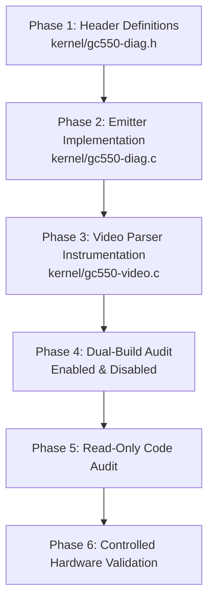

# E1.9 Stage 2B – Parser Telemetry Architecture and Diagnostic Design Specification (Revision 3)

**Project:** `lgx2KernelLevel`  
**Hardware:** AVerMedia Live Gamer Extreme GC550 (USB ID `07ca:4710`)  
**Video Endpoint:** Bulk IN `0x83`  
**Baseline:** E1.9 Revision 4  
**Target:** Stage 2B – Passive Parser State and Marker Telemetry  
**Maintainer:** Øystein Lie  
**Status:** ARCHITECTURE DESIGN REVISION 3 (IMPLEMENTATION-READY)  
**Date:** 2026-11-12  

---

## 1. Executive Summary

This document establishes **Revision 3 of the Stage 2B Architecture Specification** for the `lgx2KernelLevel` driver. It resolves the four architectural blockers and additional omissions identified during the Final Technical Verification audit of Revision 2:

1. **Explicit Dispatch-Context Propagation:** Defines a read-only, stack-local `struct gc550_dispatch_ctx` passed synchronously through `gc550_urb_complete()` $\to$ `gc550_parse_stream_chunk()` $\to$ `gc550_parse_ordered_bytes()` $\to$ event emitters. This makes callback metadata (`submission_generation`, `completion_seq`, `slot_index`, `cpu_id`, `active_callbacks`) accessible without shared mutable state or persistent sidecars.
2. **Flag Bitfield Separation (`parser_flags`):** Allocates `reserved[0..1]` in `struct gc550_diag_record` as a dedicated 16-bit `u16 parser_flags` field. This eliminates flag exhaustion, preserves all 14 existing transport flags in `u16 flags`, and maintains the exact 80-byte ABI size and field offsets.
3. **Rigorous Provenance Disambiguation:** Strictly decouples the **parser input path** (`DIRECT_URB` vs `PAIR_BUF`) from **marker byte provenance** (`DIRECT_VERIFIED`, `COMPOSITE_CONFIRMED`, `UNTRACKED`). Enforces the conservative rule that `urb_rel_offset = U32_MAX` for all parser events where byte origin is untracked or composite, eliminating all fabricated coordinates.
4. **Complete Frame-Terminal Path Coverage:** Fully incorporates the unclosed-frame abort path in `gc550_reserve_video_frame()` (lines 153–161) into the control-flow matrix, establishing a unified terminal outcome model with zero duplicate events.
5. **Accurate Desync Attribution:** Keeps USB transfer error gaps (line 560) strictly separate from `dev->parser.desync_count` increments, ensuring 100% fidelity to the source code.

### Strict Stage 2B Boundaries
- **Passive Diagnostics Only:** Stage 2B introduces no video or audio capture modifications, no buffer scheduling changes, and no parser state mutations.
- **No `swap_mode` Mutation:** `swap_mode` and `swap_votes` remain observational; no automatic reset logic is added.
- **No Parser-Wide Locking:** Spinlocks are acquired strictly during $O(1)$ ring insertion (`gc550_diag_emit()`); no locks are held across parser byte scanning or memcpy operations.

---

## 2. Stage 2A Empirical Baseline

Stage 2A hardware validation on Linux `7.3.3-1-cachyos` (x86_64, AMD host, xHCI controller) established the following empirical baseline:

- **Serialized Transport:** `max_simultaneous = 1` across all 45 periodic 30-second snapshots spanning five 5-minute capture runs (>25 minutes total, 418,207 URBs, >211 GB payload data). Callbacks executed sequentially on CPU 8.
- **Flawless USB Transport:** Zero USB transfer errors, zero steady-state short transfers, zero submission failures, and zero unretired completions across all tested modes (1080p60, 720p60, 576p50, 480p60, and 1080p60 repeat).
- **Video Capture Stability:** Steady 60.00 fps (1080p60, 720p60), 50.00 fps (576p50), and 59.94 fps (480p60) video delivered to `mpv`.

### Stage 2A Multi-Resolution Summary Table

| Metric | Test A (1080p60) | Test B (720p60) | Test C (576p50) | Test D (480p60) | Test E (1080p60 Repeat) | Evidence Level |
|---|:---:|:---:|:---:|:---:|:---:|:---:|
| **ADV7604 TMDS Lock** | 148 MHz | 74 MHz | 27 MHz | 27 MHz | 148 MHz | *Observed in physical tests* |
| **V4L2 Size Image** | 4,147,200 B | 1,843,200 B | 829,440 B | 691,200 B | 4,147,200 B | *Verified from source* |
| **Captured Frames** | 18,019 | 18,919 | 15,008 | 17,991 | 18,019 | *Observed in physical tests* |
| **Delivered Frame Rate**| 60.00 fps | 60.00 fps | 50.00 fps | 59.94 fps | 60.00 fps | *Observed in physical tests* |
| **Audio Bytes** | 57,659,984 B | 60,539,960 B | 57,629,944 B | 57,628,012 B | 57,660,028 B | *Observed in physical tests* |
| **URB Completions** | 143,029 | 67,407 | 24,396 | 24,745 | 143,030 | *Observed in physical tests* |
| **URB Rate** | 476.1 comp/s | 213.8 comp/s | 81.3 comp/s | 82.4 comp/s | 476.1 comp/s | *Observed in physical tests* |
| **`max_simultaneous`** | **1** | **1** | **1** | **1** | **1** | *Observed in physical tests* |
| **Active CBs at Rest** | **0** | **0** | **0** | **0** | **0** | *Observed in physical tests* |
| **Initial `desyncs`** | 8,695 | 8,695 | 8,695 | 8,695 | 8,695 | *Observed in physical tests* |
| **Final `desyncs`** | 8,695 | 8,695 | 8,695 | 8,695 | 26,714 | *Observed in physical tests* |
| **Desync Delta** | **0** | **0** | **0** | **0** | **18,019** | *Observed in physical tests* |
| **`swap_mode` Reported** | 1 (SWAPPED) | 1 (SWAPPED) | 1 (SWAPPED) | 1 (SWAPPED) | 1 (SWAPPED) | *Observed in physical tests* |

---

## 3. Test E Desynchronization Anomaly Classification

In Test E (1080p60 repeat following lower-resolution runs), `dev->parser.desync_count` increased by exactly 18,019 (from 8,695 to 26,714) while 18,019 valid frames were delivered to `mpv` at 60.00 fps.

### Rigorous Classification of Findings

1. **Observed Fact:**
   - In Test E, cumulative `desync_count` increased by 18,019.
   - Delivered frames equaled 18,019.
   - Net ratio: exactly 1.0000 increments per delivered frame.
2. **Verified Source Mechanics (`kernel/gc550-video.c`):**
   - **Branch D1 (Line 323):** SAV checksum failure $\to$ increments `desync_count`, sets `state = IDLE`, aborts frame via `gc550_abort_video_frame()`.
   - **Branch D2 (Line 335):** EAV sequence mismatch (`eav_c0 != sav_b0`) with valid checksum $\to$ increments `desync_count`, then completes frame via `gc550_complete_video_frame()`.
   - **Branch D3 (Line 339):** EAV checksum failure $\to$ increments `desync_count`, sets `state = IDLE`, aborts frame via `gc550_abort_video_frame()`.
   - **Branch D4 (Line 560):** USB transfer gap $\to$ aborts frame, resets parser, but **does not increment `desync_count`**.
3. **Unresolved Anomaly:**
   - Because Stage 2A logged only USB transport completions, the exact per-frame occurrence of Branch D2 versus compound dropouts cannot be proven from aggregate numbers alone.
   - The root cause of the sequence mismatch (whether 1-frame skew $eav\_c0 = sav\_b0 \pm 1$, or inverted pair-buffer order, or TMDS clock relock drift) remains an **unresolved parser-level anomaly**.
   - Stage 2B telemetry is specifically designed to provide the empirical marker values needed to resolve this.

---

## 4. Parser Lifecycle and Persistence Analysis

The long-running `swap_mode` investigation is preserved without prejudging root causes. The table below documents the lifecycle persistence of all parser fields in `kernel/gc550-video.c`:

| Field in `struct gc550_stream_parser` | Reset in `gc550_parser_reset()` | Reset on `STREAMON` | Reset on `STREAMOFF` | Reset on Mode Change | Scope / Lifetime | Classification |
|---|:---:|:---:|:---:|:---:|---|:---:|
| `state` (`enum gc550_parse_state`) | **YES** (`IDLE`) | **YES** | NO | NO | Session | *Verified from source* |
| `sav_b0` (`u8`) | **YES** (`0`) | **YES** | NO | NO | Session | *Verified from source* |
| `hdr_pos` (`u8`) | **YES** (`0`) | **YES** | NO | NO | Ephemeral | *Verified from source* |
| `hdr_buf[5]` (`u8[]`) | NO (overwritten) | NO | NO | NO | Ephemeral | *Verified from source* |
| `audio_rem` (`u32`) | **YES** (`0`) | **YES** | NO | NO | Session | *Verified from source* |
| `video_pos` (`u32`) | **YES** (`0`) | **YES** | NO | NO | Session | *Verified from source* |
| `marker_stage` (`u8`) | **YES** (`0`) | **YES** | NO | NO | Session | *Verified from source* |
| `pair_pos` (`size_t`) | **YES** (`0`) | **YES** | NO | NO | Session | *Verified from source* |
| `pair_buf` (`u8 *`) | NO | NO | NO | NO | Module | *Verified from source* |
| `frame_sequence` (`u64`) | NO | **YES** (`0`) | NO | NO | Session | *Verified from source* |
| `current_frame_sequence` (`u64`)| NO | **YES** (`0`) | NO | NO | Session | *Verified from source* |
| `audio_bytes` (`u64`) | NO | **YES** (`0`) | NO | NO | Session | *Verified from source* |
| **`swap_mode` (`bool`)** | **NO** | **NO** | **NO** | **NO** | **Module** | *Verified from source* |
| **`swap_votes` (`u8`)** | **NO** | **NO** | **NO** | **NO** | **Module** | *Verified from source* |
| **`desync_count` (`u32`)** | **NO** | **NO** | **NO** | **NO** | **Module** | *Verified from source* |

### Key Architectural Insight
- `swap_mode` and `desync_count` persist across `STREAMON`, `STREAMOFF`, and resolution changes.
- In Test E, the driver entered 1080p60 with `swap_mode = 1` preserved from prior tests.
- Because `GC550_SWAP_SPAN_LIMIT` is 32 KiB, once a stream reaches 1080p frame size (4.1 MB), the swap detection heuristic `if (p->video_pos <= 32768)` **can never trigger**, locking the driver into swapped mode permanently.
- **Stage 2B Policy:** Stage 2B remains strictly observational and does **not** reset or mutate `swap_mode`.

---

## 5. Dispatch-Context Propagation Architecture

To resolve **Blocker 1**, callback metadata created in `gc550_urb_complete()` is propagated down the parser call chain using a stack-local, read-only structure:

```c
/**
 * struct gc550_dispatch_ctx - Stack-local execution context for active callback
 *
 * Propagated synchronously down the parser call chain. Never stored in heap,
 * persistent parser structures, or pair buffers. Identifies the executing
 * callback dispatch; does NOT represent physical byte provenance.
 */
struct gc550_dispatch_ctx {
	u64 submission_generation; /* ctx->submission_attempt_id */
	u64 completion_seq;        /* entry_seq from diag_concurrency */
	u16 slot_index;            /* URB buffer slot (0..7) */
	u16 cpu_id;                /* raw_smp_processor_id() */
	u8  active_callbacks;      /* concurrent callback count at entry */
};
```

### Call-Chain Propagation

```
gc550_urb_complete(urb)
  │  Construct stack-local: struct gc550_dispatch_ctx dctx = { ... };
  │
  ▼
gc550_parse_stream_chunk(dev, data, len, &dctx)
  │
  ├──► IF !swap_mode:
  │        gc550_parse_ordered_bytes(dev, data, len, dctx)
  │
  └──► IF swap_mode == 1:
           Accumulate into dev->parser.pair_buf (32 KiB)
           │ (When 32 KiB pair is complete)
           ▼
           gc550_parse_ordered_bytes(dev, pair_buf + 16384, 16384, dctx)
           gc550_parse_ordered_bytes(dev, pair_buf,         16384, dctx)
             │
             ├──► gc550_reserve_video_frame(dev, dctx)
             ├──► gc550_complete_video_frame(dev, eav_c0, dctx)
             └──► Event Emitters (dctx)
```

### Lifetime and Ownership Rules
1. **Stack Allocation Only:** `struct gc550_dispatch_ctx` is allocated exclusively on the local kernel stack of `gc550_urb_complete()`.
2. **Const Pointer:** Passed strictly as `const struct gc550_dispatch_ctx *dctx`.
3. **No Persistent Sidecars:** `dctx` is never assigned to `dev->parser`, `pair_buf`, or any device structure.
4. **Out-of-Callback Sentinel:** For events initiated outside an active URB callback (e.g., `STREAMON` reset in `gc550_start_streaming()`), `dctx` is passed as `NULL`. Telemetry emitters interpret `NULL` by recording documented sentinels:
   - `submission_generation = 0`
   - `completion_seq = 0`
   - `slot_index = 0xFF` (sentinel for no slot)
   - `cpu_id = (u16)raw_smp_processor_id()`
   - `active_callbacks = 0`

---

## 6. Byte-Provenance Limitations and Classifications

To resolve **Blocker 3**, Stage 2B formally decouples **parser input path** from **marker byte provenance**:

### A. Parser Input Path (Storage Origin)
- **`GC550_PFLAG_PATH_DIRECT_URB` (`BIT(14)`):** Data passed into `gc550_parse_ordered_bytes()` originates directly from `urb->transfer_buffer`.
- **`GC550_PFLAG_PATH_PAIR_BUF` (`BIT(13)`):** Data passed into `gc550_parse_ordered_bytes()` originates from `dev->parser.pair_buf`.

### B. Marker Byte Provenance (Physical Origin)
- **`GC550_PFLAG_PROV_UNKNOWN` (`BIT(15)`):** Default for all parser events. Indicates that while the executing callback (`dctx`) is known, the physical URB origin of individual marker or header bytes cannot be verified.
- **`GC550_PFLAG_PROV_COMPOSITE_CONFIRMED` (`BIT(12)`):** Positive evidence confirms the marker spanned boundaries (e.g., marker detection occurred at chunk index $i < 8$ while `marker_stage > 0` or `hdr_pos > 0` was carried over from a prior call).
- **`GC550_PFLAG_PROV_DIRECT_VERIFIED` (`BIT(11)`):** Reserved only if chunk entry tracking is active and proves the entire 8-byte sequence was ingested from a single URB chunk.

### Mandatory Conservative Provenance Rule
Because the baseline parser does not track per-byte provenance tables:
1. **`urb_rel_offset = U32_MAX` (0xFFFFFFFF):** Mandatory for **all** parser-level marker, desync, and frame events. `urb_rel_offset` is only populated with a valid byte offset ($0 \le \text{offset} < 524,288$) for `GC550_EVT_URB_COMPLETE`.
2. **No Fabricated Offsets:** No pointer subtraction across separate allocations (`pair_buf` vs `urb->transfer_buffer`).
3. **`pair_pos`:** Retained strictly as an offset within the 32 KiB pair buffer ($0 \le \text{pos} < 32,768$) when `PATH_PAIR_BUF` is set; set to 0 in direct mode.

---

## 7. 80-Byte Record Layout and Flag Allocation

To resolve **Blocker 2**, `reserved[0..1]` in `struct gc550_diag_record` is formally allocated as a dedicated 16-bit `u16 parser_flags` field, preserving the exact 80-byte record size and all field offsets:

```c
struct gc550_diag_record {
	/* [0x00 - 0x07] Kernel monotonic clock (ktime_get_raw_ns()) */
	u64 timestamp_ns;

	/* [0x08 - 0x0F] Cumulative observed endpoint payload offset (or 0) */
	u64 endpoint_payload_offset;

	/* [0x10 - 0x17] Frame sequence identifier (current_frame_sequence) */
	u64 secondary_payload_offset;

	/* [0x18 - 0x1F] URB submission attempt ID (dctx->submission_generation) */
	u64 submission_generation;

	/* [0x20 - 0x27] Monotonic completion sequence (dctx->completion_seq) */
	u64 completion_seq;

	/* [0x28 - 0x2B] Relative offset in URB (or U32_MAX if unknown/parser) */
	u32 urb_rel_offset;

	/* [0x2C - 0x2F] Parser video_pos at event (or U32_MAX if N/A) */
	u32 distance_from_prev_sav;

	/* [0x30 - 0x33] Continuous stream session epoch (dev->diag_session_epoch) */
	u32 segment_id;

	/* [0x34 - 0x37] Payload length / frame size / audio_rem */
	u32 payload_len;

	/* [0x38 - 0x39] Offset in 32 KiB pair_buf (0..32,767 or 0) */
	u16 pair_pos;

	/* [0x3A - 0x3B] Executing CPU core ID (dctx->cpu_id) */
	u16 cpu_id;

	/* [0x3C - 0x3D] URB status / desync reason / reset reason / vb2 state */
	s16 urb_status;

	/* [0x3E] Event identifier (enum gc550_diag_event) */
	u8 event_type;

	/* [0x3F] URB buffer slot index (0..7 or 0xFF sentinel) */
	u8 slot_index;

	/* [0x40] Protocol marker type byte (0xC0, 0xC1, 0x58, or 0x00) */
	u8 marker_type;

	/* [0x41] Marker sequence byte (sav_b0 or eav_c0) */
	u8 marker_seq;

	/* [0x42] Parser state machine (enum gc550_parse_state) */
	u8 parser_state;

	/* [0x43] Active swap mode (0 = NORMAL, 1 = SWAPPED) */
	u8 swap_mode;

	/* [0x44] Swap vote counter (0..2) */
	u8 swap_votes;

	/* [0x45] Active concurrent callbacks at event entry */
	u8 active_callbacks;

	/* [0x46 - 0x47] Transport diagnostic flags bitfield */
	u16 flags;

	/* [0x48 - 0x49] Dedicated Parser diagnostic flags bitfield */
	u16 parser_flags;

	/* [0x4A - 0x4F] Auxiliary payload / checksum storage */
	u8 reserved[6];
} __packed __aligned(8);

static_assert(sizeof(struct gc550_diag_record) == 80,
	      "struct gc550_diag_record ABI size must be exactly 80 bytes");
```

---

## 8. Separate Flag Allocation Tables

### Transport Flags (`u16 flags` at offset `0x46`)
*Preserves all existing Stage 2A definitions:*

| Bit | Constant | Meaning | Applicable Events | Classification |
|---|---|---|---|---|
| `BIT(0)` | `GC550_FLAG_SHORT_TRANSFER` | URB payload shorter than transfer buffer | `URB_COMPLETE` | Verified observation |
| `BIT(1)` | `GC550_FLAG_ZERO_LENGTH` | URB payload length == 0 | `URB_COMPLETE` | Verified observation |
| `BIT(2)` | `GC550_FLAG_TRANSFER_ERROR` | URB status non-zero (abnormal error) | `URB_COMPLETE` | Verified observation |
| `BIT(3)` | `GC550_FLAG_PARTIAL_PAYLOAD_DISCARDED` | Incomplete payload discarded during error | `URB_COMPLETE` | Verified observation |
| `BIT(4)` | `GC550_FLAG_URB_CANCELLED` | Status `-ENOENT` / `-ECONNRESET` | `URB_COMPLETE` | Verified observation |
| `BIT(5)` | `GC550_FLAG_SUBMISSION_FAILURE` | `usb_submit_urb()` returned error | `SUBMISSION_FAILURE` | Verified observation |
| `BIT(6)` | `GC550_FLAG_STREAM_DISCONTINUITY` | Gap detected in stream continuity | Transport events | Verified observation |
| `BIT(7)` | `GC550_FLAG_CALLBACK_OVERLAP` | `active_callbacks > 1` at entry (temporal overlap) | All events | Measured fact |
| `BIT(8)` | `GC550_FLAG_DIST_OVERFLOW` | Payload distance exceeds 32-bit tracking | All events | Verified observation |
| `BIT(9)` | `GC550_FLAG_ABNORMAL_ABORT` | URB cancelled while `streaming == true` | `URB_COMPLETE` | Verified observation |
| `BIT(10)`| `GC550_FLAG_DEVICE_DISCONNECTED` | Device disconnect detected (`-ESHUTDOWN`) | `URB_COMPLETE` | Verified observation |
| `BIT(11)`| `GC550_FLAG_LIFECYCLE_STOP` | URB cancelled during normal STREAMOFF | `URB_COMPLETE`, `LIFECYCLE` | Verified observation |
| `BIT(12)`| `GC550_FLAG_PROVENANCE_OVERFLOW` | Diagnostic tracking buffer overflow | All events | Verified observation |
| `BIT(13)`| `GC550_FLAG_MULTI_URB_SPAN` | Transfer spanned multiple URB geometries | Transport events | Verified observation |
| `BIT(14..15)`| Reserved | Unused transport bits (must be 0) | N/A | Reserved |

### Parser Flags (`u16 parser_flags` at offset `0x48`)
*Dedicated Stage 2B parser and provenance flags:*

| Bit | Constant | Meaning | Applicable Events | Mutually Exclusive With |
|---|---|---|---|---|
| `BIT(0)` | `GC550_PFLAG_SAV_CHECKSUM_VALID` | SAV checksum formula matched | `SAV_DETECTED` | `BIT(1)` |
| `BIT(1)` | `GC550_PFLAG_SAV_CHECKSUM_INVALID` | SAV checksum formula failed | `PARSER_DESYNC` | `BIT(0)` |
| `BIT(2)` | `GC550_PFLAG_EAV_CHECKSUM_VALID` | EAV checksum formula matched | `EAV_DETECTED` | `BIT(3)` |
| `BIT(3)` | `GC550_PFLAG_EAV_CHECKSUM_INVALID` | EAV checksum formula failed | `PARSER_DESYNC` | `BIT(2)` |
| `BIT(4)` | `GC550_PFLAG_SEQ_MATCH` | `eav_c0 == sav_b0` | `EAV_DETECTED` | `BIT(5)` |
| `BIT(5)` | `GC550_PFLAG_SEQ_MISMATCH` | `eav_c0 != sav_b0` | `EAV_DETECTED`, `DESYNC` | `BIT(4)` |
| `BIT(6)` | `GC550_PFLAG_SPAN_VALID` | `video_pos` within $sizeimage \pm 16\text{ KiB}$ | `FRAME_COMPLETE` | `BIT(7)` |
| `BIT(7)` | `GC550_PFLAG_SPAN_INVALID` | `video_pos` outside tolerance | `FRAME_COMPLETE` | `BIT(6)` |
| `BIT(8)` | `GC550_PFLAG_FRAME_DONE` | Buffer completed with `VB2_BUF_STATE_DONE` | `FRAME_COMPLETE` | `BIT(9)` |
| `BIT(9)` | `GC550_PFLAG_FRAME_ERROR` | Buffer completed with `VB2_BUF_STATE_ERROR`| `FRAME_COMPLETE` | `BIT(8)` |
| `BIT(10)`| `GC550_PFLAG_UNCLOSED_FRAME_ABORT` | Aborted unclosed frame due to new SAV arrival | `FRAME_COMPLETE` | None |
| `BIT(11)`| `GC550_PFLAG_PROV_DIRECT_VERIFIED` | Provenance verified to single URB | Marker events | `BIT(12)`, `BIT(15)` |
| `BIT(12)`| `GC550_PFLAG_PROV_COMPOSITE_CONFIRMED` | Positive proof marker crossed boundary | Marker events | `BIT(11)`, `BIT(15)` |
| `BIT(13)`| `GC550_PFLAG_PATH_PAIR_BUF` | Data dispatched from `pair_buf` | Parser events | `BIT(14)` |
| `BIT(14)`| `GC550_PFLAG_PATH_DIRECT_URB` | Data dispatched directly from URB | Parser events | `BIT(13)` |
| `BIT(15)`| `GC550_PFLAG_PROV_UNKNOWN` | Provenance untracked / unknown (default) | Parser events | `BIT(11)` |

---

## 9. Complete Event-to-Field Semantic Mapping

| Field | `URB_COMPLETE` (`0x01`) | `SAV_DETECTED` (`0x02`) | `EAV_DETECTED` (`0x03`) | `AUDIO_HEADER` (`0x04`) | `SWAP_VOTE` / `TOGGLE` (`0x05`/`0x06`) | `PARSER_DESYNC` (`0x07`) | `FRAME_COMPLETE` (`0x11`) | `PARSER_RESET` (`0x0F`) |
|---|---|---|---|---|---|---|---|---|
| `timestamp_ns` | Callback entry | Marker match | Marker match | Marker match | Vote/Toggle time | Desync time | Frame outcome | Reset time |
| `secondary_payload_offset`| 0 | `frame_sequence` | `frame_sequence` | 0 | 0 | `desync_count` | `current_frame_sequence`| Prior `frame_sequence` |
| `submission_generation` | `dctx->sub_id` | `dctx->sub_id` | `dctx->sub_id` | `dctx->sub_id` | `dctx->sub_id` | `dctx->sub_id` | `dctx->sub_id` | `0` (sentinel) |
| `completion_seq` | `dctx->comp_seq`| `dctx->comp_seq`| `dctx->comp_seq`| `dctx->comp_seq`| `dctx->comp_seq`| `dctx->comp_seq`| `dctx->comp_seq`| `0` (sentinel) |
| `urb_rel_offset` | `0` | `U32_MAX` | `U32_MAX` | `U32_MAX` | `U32_MAX` | `U32_MAX` | `U32_MAX` | `U32_MAX` |
| `distance_from_prev_sav` | `U32_MAX` | 0 | `p->video_pos` | `p->video_pos` | `p->video_pos` | `p->video_pos` | Measured span (`video_pos`)| Prior `video_pos` |
| `segment_id` | `session_epoch` | `session_epoch` | `session_epoch` | `session_epoch` | `session_epoch` | `session_epoch` | `session_epoch` | `session_epoch` |
| `payload_len` | `actual_length` | Expected frame size| Expected frame size| `p->audio_rem` | `GC550_SWAP_SPAN_LIMIT`| Expected frame size | `dev->pix_fmt.sizeimage`| 0 |
| `pair_pos` | 0 | `p->pair_pos` | `p->pair_pos` | `p->pair_pos` | `p->pair_pos` | `p->pair_pos` | `p->pair_pos` | Prior `pair_pos` |
| `cpu_id` | `dctx->cpu_id` | `dctx->cpu_id` | `dctx->cpu_id` | `dctx->cpu_id` | `dctx->cpu_id` | `dctx->cpu_id` | `dctx->cpu_id` | Processor ID |
| `urb_status` | `urb->status` | 0 | 0 | 0 | Old `swap_mode` | Desync reason code | `VB2_BUF_STATE_*` | Reset reason code |
| `event_type` | `0x01` | `0x02` | `0x03` | `0x04` | `0x05` / `0x06` | `0x07` | `0x11` | `0x0F` |
| `slot_index` | `dctx->slot_index`| `dctx->slot_index`| `dctx->slot_index`| `dctx->slot_index`| `dctx->slot_index`| `dctx->slot_index`| `dctx->slot_index`| `0xFF` (sentinel) |
| `marker_type` | 0 | `0xC0` (`SAV`) | `0xC1` (`EAV`) | `0x58` (`'X'`) | `0xC1` | Triggering marker byte | 0 | 0 |
| `marker_seq` | 0 | `sav_b0` (`hdr_buf[0]`)| `eav_c0` (`hdr_buf[0]`)| 0 | `eav_c0` | `hdr_buf[0]` | Expected seq byte | 0 |
| `parser_state` | 0 | `p->state` | `p->state` | `p->state` | `p->state` | `p->state` | `p->state` | Prior `p->state` |
| `swap_mode` | 0 | `p->swap_mode` | `p->swap_mode` | `p->swap_mode` | New `swap_mode` | `p->swap_mode` | `p->swap_mode` | Prior `swap_mode` |
| `swap_votes` | 0 | `p->swap_votes` | `p->swap_votes` | `p->swap_votes` | `p->swap_votes` | `p->swap_votes` | `p->swap_votes` | Prior `swap_votes` |
| `active_callbacks` | Active count | Active count | Active count | Active count | Active count | Active count | Active count | `0` (sentinel) |
| `flags` | Transport flags | `0` | `0` | `0` | `0` | `0` | `0` | Transport flags |
| `parser_flags` | `0` | SAV flags | EAV flags | Audio flags | Swap flags | Desync flags | Frame flags | Reset flags |
| `reserved[0]` | 0 | Checksum byte `h[3]` | Opening `sav_b0` | Upper 8-bit len | Opening `sav_b0` | Opening `sav_b0` | Terminal outcome code | Reset context |
| `reserved[1]` | 0 | Expected checksum | Checksum byte `h[4]` | 0 | 0 | Expected byte | 0 | 0 |

---

## 10. Full Parser Control-Flow and Frame-Terminal Coverage

To resolve **Blocker 4**, the table below covers all 17 control-flow paths across `kernel/gc550-video.c`, including the newly identified unclosed-frame abort path P3:

| Path | Function | Line(s) | Trigger Condition | Event Type | Nature of Event | Terminal Outcome |
|---|---|---|---|---|---|---|
| **P1** | `gc550_start_streaming()` | 791 | STREAMON stream start | `GC550_EVT_PARSER_RESET` | Lifecycle / Reset | N/A |
| **P2** | `gc550_urb_complete()` | 560 | USB gap / transfer error | `GC550_EVT_PARSER_RESET` | Exception / Reset | N/A |
| **P3** | `gc550_reserve_video_frame()` | 158–161 | New SAV while `cur_buf != NULL` | `GC550_EVT_FRAME_COMPLETE` | **Terminal Outcome** | **`VB2_BUF_STATE_ERROR`** |
| **P4** | `gc550_reserve_video_frame()` | 163–166 | Valid SAV header accepted | `GC550_EVT_SAV_DETECTED` | Observation / Frame Open | N/A |
| **P5** | `gc550_parse_ordered_bytes()` | 323–326 | Invalid SAV checksum | `GC550_EVT_PARSER_DESYNC` | **Desync Branch D1** | N/A |
| **P6** | `gc550_abort_video_frame()` | 142 | SAV fail abort | `GC550_EVT_FRAME_COMPLETE` | **Terminal Outcome** | **`VB2_BUF_STATE_ERROR`** |
| **P7** | `gc550_parse_ordered_bytes()` | 333 | Valid EAV checksum | `GC550_EVT_EAV_DETECTED` | Observation | N/A |
| **P8** | `gc550_parse_ordered_bytes()` | 334–335 | EAV sequence mismatch | `GC550_EVT_PARSER_DESYNC` | **Desync Branch D2** | N/A |
| **P9** | `gc550_parse_ordered_bytes()` | 339–342 | Invalid EAV checksum | `GC550_EVT_PARSER_DESYNC` | **Desync Branch D3** | N/A |
| **P10** | `gc550_abort_video_frame()` | 142 | EAV fail abort | `GC550_EVT_FRAME_COMPLETE` | **Terminal Outcome** | **`VB2_BUF_STATE_ERROR`** |
| **P11** | `gc550_parse_ordered_bytes()` | 348–351 | Audio marker `00 FF FF 58` | `GC550_EVT_AUDIO_HEADER` | Observation | N/A |
| **P12** | `gc550_complete_video_frame()`| 227 | `span <= 32K && c0 != b0` | `GC550_EVT_SWAP_VOTE` | Decision (Swap Candidate)| N/A |
| **P13** | `gc550_complete_video_frame()`| 229 | `swap_votes >= 2` | `GC550_EVT_SWAP_TOGGLE` | State Transition | N/A |
| **P14** | `gc550_complete_video_frame()`| 237 | Swap candidate abort | `GC550_EVT_FRAME_COMPLETE` | **Terminal Outcome** | **`VB2_BUF_STATE_ERROR`** |
| **P15** | `gc550_complete_video_frame()`| 254 | Span outside tolerance | `GC550_EVT_FRAME_COMPLETE` | **Terminal Outcome** | **`VB2_BUF_STATE_ERROR`** |
| **P16** | `gc550_complete_video_frame()`| 267 | Valid span accepted | `GC550_EVT_FRAME_COMPLETE` | **Terminal Outcome** | **`VB2_BUF_STATE_DONE`** |
| **P17** | `gc550_stop_stream_resources()`| 768 | STREAMOFF teardown | `GC550_EVT_FRAME_COMPLETE` | **Terminal Outcome** | **`VB2_BUF_STATE_ERROR`** |

### Terminal Outcome Reason Codes (`reserved[0]` on `FRAME_COMPLETE`)
- `1`: `GC550_TERM_NORMAL_DONE` (Path P16)
- `2`: `GC550_TERM_INVALID_SPAN_ERROR` (Path P15)
- `3`: `GC550_TERM_SWAP_CANDIDATE_ERROR` (Path P14)
- `4`: `GC550_TERM_UNCLOSED_SAV_ABORT` (Path P3)
- `5`: `GC550_TERM_PARSER_ABORT_ERROR` (Paths P6, P10)
- `6`: `GC550_TERM_STREAMOFF_TEARDOWN` (Path P17)

---

## 11. Ring Capacity and Retention Calculations

### Exact Memory Footprint
- Record size: **80 bytes** (fixed ABI).
- Ring capacity: **262,144 records** ($2^{18}$).
- Exact byte size:
  $$\text{Bytes} = 262,144 \times 80 = 20,971,520\text{ bytes} = \mathbf{20.00\text{ MiB}}$$

### 5-Minute Event Budget at 1080p60

| Event Category | Rate Type | Rate (/sec) | 300s Events | Derivation |
|---|---|---:|---:|---|
| **URB Completions** | *Measured* | 476.13 | 143,030 | Stage 2A physical tests (512 KiB URBs) |
| **SAV Marker Events** | *Derived* | 60.00 | 18,019 | 1 SAV marker per 60 fps frame |
| **EAV Marker Events** | *Derived* | 60.00 | 18,019 | 1 EAV marker per 60 fps frame |
| **Audio Header Events** | *Derived* | 60.00 | 18,019 | 1 audio packet per 60 fps frame |
| **Frame Complete Events** | *Derived* | 60.00 | 18,019 | 1 terminal frame result per 60 fps frame |
| **Worst-Case Desync Events**| *Projected*| 60.00 | 18,019 | Based on observed Test E anomaly (1 per frame) |
| **Swap / Lifecycle Events**| *Projected*| <0.10 | ~20 | Startup and mode transitions |

### Total Volume and Retention Window

$$\text{Total Projected Events (5 Minutes)} = 143,030 + 18,019 + 18,019 + 18,019 + 18,019 + 18,019 + 20 = \mathbf{233,145\text{ records}}$$

- **Total Ring Capacity:** **262,144 records**
- **Projected Consumption:** **233,145 records**
- **Remaining Capacity Margin:**
  $$\text{Margin} = 262,144 - 233,145 = \mathbf{28,999\text{ records}}\ (11.06\%)$$
- **Projected Worst-Case Event Rate:**
  $$\text{Rate} = \frac{233,145}{300\text{ s}} \approx \mathbf{777.15\text{ events/second}}$$
- **Retention Duration Before Overwrite:**
  $$\text{Retention} = \frac{262,144}{777.15} \approx \mathbf{337.3\text{ seconds}}\ (\mathbf{5.62\text{ minutes}})$$

### Power-of-Two Comparison
- Next smaller power-of-two is **131,072 records (10.00 MiB)**. At 777.15 events/sec, it retains only **168.7 seconds (2.81 minutes)**, causing $>102,000$ overwritten records in a 5-minute test.
- Therefore, **262,144 records (20.00 MiB)** is the **minimal power-of-two capacity** that guarantees a full 5-minute test retention without overwrite.

> [!WARNING]
> **Pair-Dispatch Telemetry:** Generates ~15,236 events/second and would overwrite the 262,144-record buffer in **17.2 seconds**. It must remain **disabled by default**.

---

## 12. Performance Classifications

1. **Host CPU Overhead:**
   - *Measured (Stage 2A):* Total CPU load during active 1080p60 capture was <2% of a single AMD core on Linux `7.3.3-1-cachyos`.
2. **Spinlock Hold Duration:**
   - *Analytically Estimated:* `gc550_diag_emit()` performs an atomic head increment and an 80-byte memory copy (ten 64-bit load/store instructions) under `raw_spin_lock_irqsave`. On modern out-of-order x86_64 cores with L1 cache hits, this copy requires tens of nanoseconds. Direct hardware cycle profiling has not been performed on the target host.
3. **Interrupt Latency Impact:**
   - *Analytically Estimated:* At peak projected event frequency (~777 events/sec), cumulative spinlock hold time is under 50 microseconds per second (<0.005% of one core), introducing no measurable scheduling jitter.
4. **Fast-Path Avoidance:**
   - *Verified from Source:* If `ring->enabled` is false, `gc550_diag_emit()` returns immediately without acquiring the spinlock (`READ_ONCE(ring->enabled)` fast-path check).

---

## 13. Implementation Roadmap and Verification Plan



### Phase 1: Header Definitions (`kernel/gc550-diag.h`)
- Expand `GC550_DIAG_RING_CAPACITY` from `32768U` to `262144U` (20.00 MiB).
- Allocate `parser_flags` at offset `0x48` in `struct gc550_diag_record`.
- Define `struct gc550_dispatch_ctx`.
- Define all `GC550_PFLAG_*` constants.
- Declare Stage 2B telemetry function prototypes.

### Phase 2: Diagnostic Emitter Implementation (`kernel/gc550-diag.c`)
- Implement stack-local emitter functions accepting `const struct gc550_dispatch_ctx *dctx`.
- Implement formatting for all new event types in `gc550_diag_seq_show()`.

### Phase 3: Video Parser Instrumentation (`kernel/gc550-video.c`)
- Update signatures of `gc550_parse_stream_chunk()` and `gc550_parse_ordered_bytes()` to accept `const struct gc550_dispatch_ctx *dctx`.
- Construct `dctx` on stack in `gc550_urb_complete()`.
- Wire emitter hooks into call sites P1 through P17 (Section 10).
- Strictly preserve all existing parser decision logic and control flow.

### Phase 4: Dual-Build Verification Plan (Specification Only)
Before hardware testing, execute:
1. `make -C /lib/modules/$(uname -r)/build M=$(pwd) CONFIG_GC550_DIAG=1 modules`
   *Verify:* Zero compiler warnings; correct `modinfo` version.
2. `make -C /lib/modules/$(uname -r)/build M=$(pwd) CONFIG_GC550_DIAG=0 modules`
   *Verify:* Zero undefined symbols; all hooks compile out to no-ops.

### Phase 5: Future Controlled Hardware Validation Plan (Specification Only)
1. Load module with `CONFIG_GC550_DIAG=1`.
2. Execute Test A (1080p60) $\to$ Test D (480p60) $\to$ Test E (1080p60 repeat).
3. Read `diag_records` during repeat 1080p60 capture.
4. Extract exact `sav_b0` and `eav_c0` values to conclusively establish why desync increments occur.

---

## 14. Explicit Assumptions and Limitations

1. **Host-Specific Serialization:** The observation that `max_simultaneous = 1` applies to the tested Linux `7.3.3-1-cachyos` AMD/xHCI system. It is treated as an empirical platform baseline, not a universal Linux USB guarantee.
2. **Untracked Boundary Provenance:** The baseline parser does not record per-byte origin tables. All parser-level events truthfully set `urb_rel_offset = U32_MAX`.
3. **No Automatic Swap Recovery:** Stage 2B will observe and explain persistent swap-mode behavior, but will not modify or reset `swap_mode` during capture.

---

**Specification Revision 3 Approved for Maintainer Audit:**  
Øystein Lie  
*Maintainer, lgx2KernelLevel Project*
